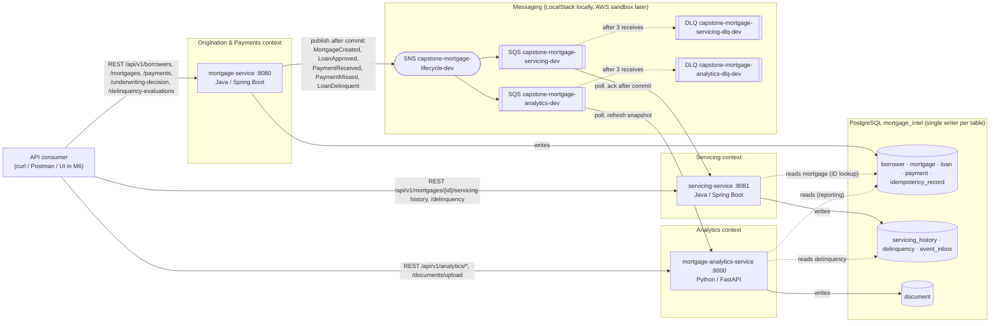

# Application Architecture

Logical services, data ownership, and communication paths for the platform as of **Milestone 5**. Ownership details: [service-ownership-matrix.md](./service-ownership-matrix.md). Decision record: [ADR-002](../adr/ADR-002-microservices-decomposition.md). Events: [event-catalog.md](./event-catalog.md).

## Service boundary diagram

Solid arrows are writes or calls. Dotted arrows are read-only access or redrive.

## Boundaries in one line each

- **mortgage-service** decides: it creates mortgages, records underwriting decisions, posts payments, and applies the 30-day delinquency rule. It is the only event publisher.
- **servicing-service** records: it turns events into the servicing history and the delinquency snapshot, and serves them.
- **analytics-service** reports: it reads canonical tables for portfolio metrics and refreshes a portfolio snapshot when events arrive.

## Cyclic dependencies

There are none. The only runtime coupling between services is the one-way event flow from mortgage-service to the consumers. No service calls another's REST API, and consumers never publish to the lifecycle topic. The M4 cross-writes (mortgage-service writing `servicing_history` and `delinquency`) were removed in M5. Shared-database **reads** remain and are listed in the ownership matrix and ADR-002.

## Request → event → projection example (payment)

1. `POST /api/v1/mortgages/MTG-1001/payments` with `X-Correlation-Id: 7c9e…` → mortgage-service saves the `payment`, reduces `mortgage.outstanding_balance`, and commits.
2. After commit it publishes `PaymentReceived` (`correlationId` = `7c9e…`) to SNS.
3. SNS delivers to both queues. servicing-service writes `servicing_history(PAYMENT_POSTED)` and `event_inbox` in one transaction, then deletes the message. analytics-service refreshes its snapshot.
4. On failure the message stays in the queue, is retried after 30 s, and after 3 receives moves to the DLQ. The final attempt is logged at ERROR.
