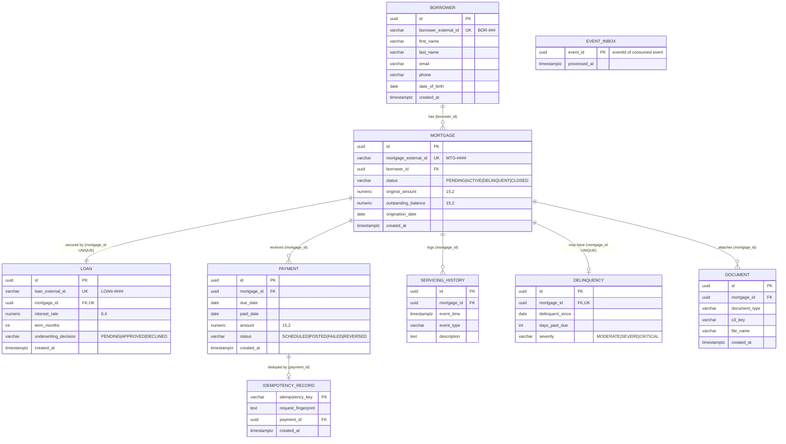

# Entity Relationship Diagram

Physical model implemented by `database/migrations/001_core_schema.sql` (M2 baseline from the reference data model) plus `002_event_inbox_and_indexes.sql` and `003_idempotency_record.sql` (M5). Column details: [data-dictionary.md](./data-dictionary.md). Write ownership per table: [service-ownership-matrix.md](./service-ownership-matrix.md).

## Cardinality and keys

| Relationship | Cardinality | Enforced by |
| --- | --- | --- |
| borrower → mortgage | 1 to 0..n | `mortgage.borrower_id` FK |
| mortgage → loan | 1 to 1 | `loan.mortgage_id` FK + UNIQUE |
| mortgage → payment | 1 to 0..n | `payment.mortgage_id` FK |
| mortgage → servicing_history | 1 to 0..n | `servicing_history.mortgage_id` FK |
| mortgage → delinquency | 1 to 0..1 (current snapshot) | `delinquency.mortgage_id` FK + UNIQUE (upserted from `LoanDelinquent`) |
| mortgage → document | 1 to 0..n | `document.mortgage_id` FK |
| payment → idempotency_record | 1 to 0..1 | `idempotency_record.payment_id` FK |
| event_inbox | standalone | PK `event_id` = dedupe key for the servicing consumer |

Every table uses a UUID surrogate PK (`gen_random_uuid()`, pgcrypto). Business keys (`borrower_external_id`, `mortgage_external_id`, `loan_external_id`) are UNIQUE and are the only identifiers exposed in APIs and events. Indexes: `idx_mortgage_borrower`, `idx_mortgage_status`, `idx_payment_mortgage_due`, `idx_servicing_mortgage_time`, `idx_document_mortgage` (rationale in [query-notes.md](./query-notes.md)).
