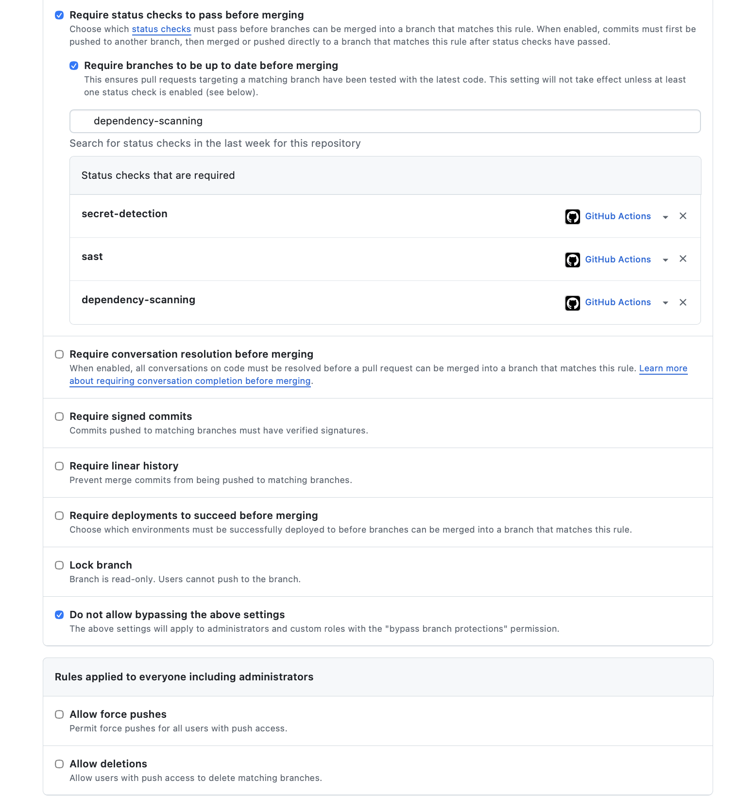
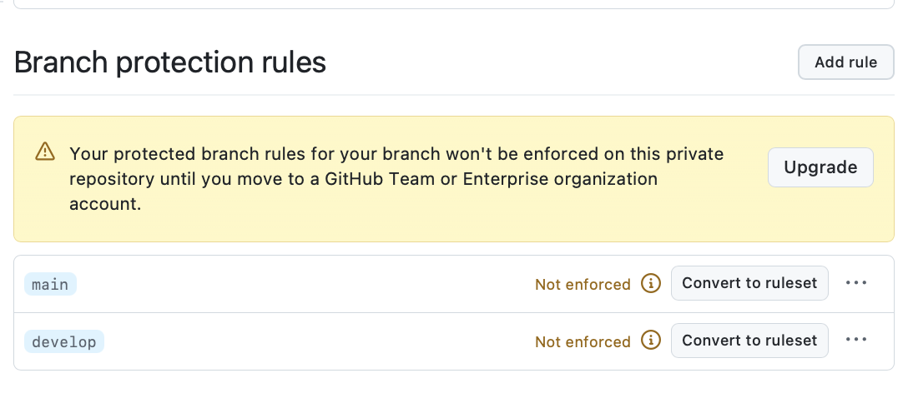
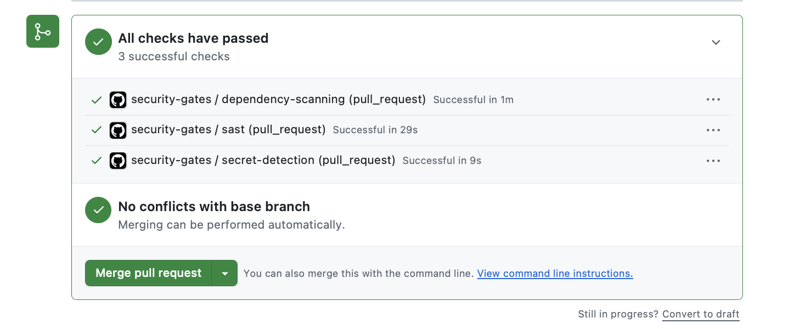
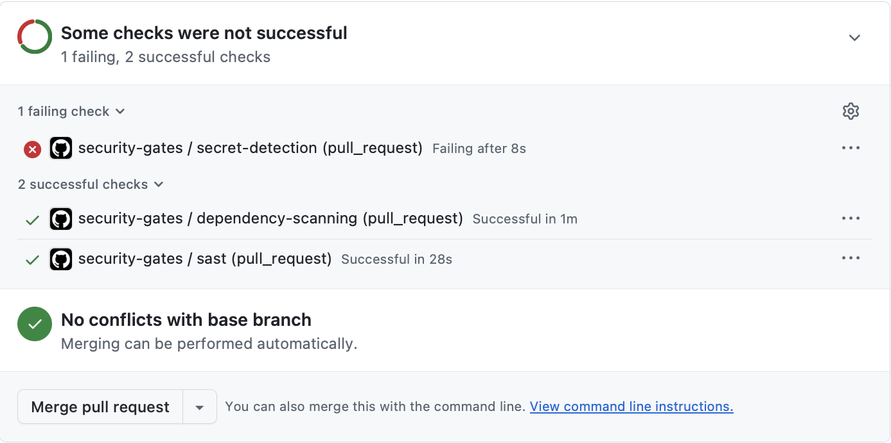

# DevSecOps Baseline

Task 2.6 (M2) set up the repository controls. **Task 6.7 (M6)** adds blocking security gates to CI. The full build, scan and deploy pipeline comes in M9.

## Repository security settings (GitHub)

- **Secret scanning** enabled on the repository (M2).
- **Branch protection** rules on `develop` and `main` (M2, reworked in M6 for a single-developer repository):
  - a pull request is required before merging;
  - **no required approvals**, because GitHub never lets a PR author approve their own PR, so with one developer a required approval would block every merge. Independent review comes from the instructor review of the security artifacts and the milestone demo;
  - the three security gates are **required status checks**, sourced from GitHub Actions, with branches required to be up to date;
  - **no bypass**, so the rules apply to administrators too;
  - force pushes and deletions blocked.

  
- **Platform limitation (documented, accepted):** this is a **private repository on a free personal GitHub plan**. GitHub stores the rules above but marks them **"Not enforced"**. Enforcement needs a public repository or a GitHub Team/Enterprise organization. The gates still run on every PR and turn red on a violation (evidence below), but GitHub doesn't disable the merge button. The compensating control is the team rule that **a PR with a red security check is never merged**. The rules become enforced unchanged once the repository moves to an organization plan, which is planned for the M9 deployment setup ([risk register R-16](../security/risk-register.md)).

  

## Security gates (Task 6.7)

The gates are defined once in [`scripts/security-gates.sh`](../../scripts/security-gates.sh) and called from both [`.github/workflows/security-gates.yml`](../../.github/workflows/security-gates.yml) (runs on this GitHub repo) and [`.gitlab-ci.yml`](../../.gitlab-ci.yml) (the curriculum's GitLab pipeline). Locally, the same command runs each tool in its pinned Docker image, so a laptop result matches CI.

| Gate | Tool (pinned) | Scope | Fails the pipeline when | Config |
| --- | --- | --- | --- | --- |
| Secret detection | gitleaks `v8.30.1` | **full git history** of the repo | **any** finding | [`.gitleaks.toml`](../../.gitleaks.toml): built-in rules + allowlist for the named test fixtures only |
| Secret gate self-test | gitleaks | a throwaway repo with a freshly generated fake key | the planted key is **not** detected (proves the gate works) | `security-gates.sh selftest` |
| SAST | Semgrep `1.178.0` | production code in all three services + TS client | any **ERROR**-severity finding | registry rulesets `p/owasp-top-ten`, `p/java`, `p/python`, `p/typescript`, plus [project rules](../../security/semgrep/capstone-rules.yml); scope in [`.semgrepignore`](../../.semgrepignore) |
| SQL guard | `tests/security/test_static_sql.py` | Java + Python sources | string-built SQL (M6 Task 6.3) | in the test |
| Dependency scanning (Java, npm) | Trivy `0.75.0` | `services/*/pom.xml` with transitive dependencies, resolved by Maven first and scanned **offline** against the local Maven repository; `clients/mortgage-api-consumer/package-lock.json` including dev/build dependencies | a **CRITICAL** CVE that has a fixed version (HIGH and CRITICAL are reported either way). A scan that can't run also fails, labelled as a scan error, not a CVE | [`.trivyignore`](../../.trivyignore) for accepted CVEs |
| Dependency scanning (Python) | pip-audit `≥ 2.9` | analytics runtime + dev requirements, resolved in a clean venv on Python 3.14.7 | **any** known vulnerability (pip-audit has no severity filter, and unpinned requirements resolve to current releases) | `--ignore-vuln` only with a risk-register entry |

The project SAST rules turn decisions from `docs/security/` into checks, so they can't quietly regress:

- no SQL built with f-strings or concatenation (Python and Java);
- no JWT decoding without signature verification;
- no disabled TLS verification (Python and TypeScript);
- no hard-coded JWT signing key;
- no `Authorization` header in logs.

**Why these thresholds.** A secret in history is always an incident (rotate it first: [runbook](./runbook.md#if-a-secret-was-committed-to-git)), so the secret gate is zero-tolerance. Critical CVEs with an available fix block the merge, per team policy (risk [R-16](../security/risk-register.md)). HIGH findings are reported and go into the [remediation backlog](../security/remediation-backlog.md) rather than blocking every PR. M9 revisits this when image scanning is added.

**First findings from this policy:**

- Preparing the dependency gate showed that Spring Boot 3.2.5 shipped Tomcat 10.1.20 with Critical CVEs, so both services moved to Spring Boot 3.5.16 with Tomcat 10.1.61.
- The gate's first full run then found a Critical in Netty and High findings in Jackson and the PostgreSQL driver. All were fixed by version overrides ([VULN-M6-018](../security/vulnerability-report.md#vuln-m6-018-dependencies-with-known-critical-cves-critical-fixed-in-task-67)).
- Two Spring Framework CVEs that have no open-source 6.2.x fix are the only accepted entries, and they expire on 2026-12-31 ([VULN-M6-019](../security/vulnerability-report.md#vuln-m6-019-spring-framework-62-cves-without-an-open-source-fix-low-risk-accepted-until-2026-12-31)).

### Run the gates locally

Docker Desktop needs to be running. The first run pulls the images and the vulnerability database, which takes a few minutes; later runs use the cache in `reports/.cache/`.

```bash
cd ~/projects/mortgage-platform
sh scripts/security-gates.sh all        # secrets + SAST + dependency scanning; non-zero exit = merge would be blocked
sh scripts/security-gates.sh selftest   # proves the secret gate catches a planted fake key
```

Reports land in `reports/security/`, which is git-ignored.

### Troubleshooting

| Symptom | Cause | Fix |
| --- | --- | --- |
| `remote Maven repository returned 429 Too Many Requests` | Maven Central rate-limits clients that fetch hundreds of POMs at once (Trivy with an empty cache) | The gate now resolves with Maven first and runs Trivy with `--offline-scan`. If your IP is already blocked, wait for the `Retry-After` (about 30 minutes) and re-run. |
| `could not resolve Maven dependencies` | no network, or the block above | same as above; the gate fails closed, so nothing merges unscanned |
| `trivy scan error (exit N)` | the scanner itself failed (network, disk, bad flag) | read `reports/security/trivy-<service>.txt`; this is **not** a CVE result |
| gitleaks finds a value in an old commit | real secret, or a test fixture committed before the gate existed | real secret: rotate first ([runbook](./runbook.md#if-a-secret-was-committed-to-git)). Fixture: add an exact-match regex to `.gitleaks.toml` with a comment saying where it lives |

### Exceptions

| Kind | How | Who approves |
| --- | --- | --- |
| False-positive secret (test fixture) | add an exact-match regex to the `.gitleaks.toml` allowlist with a comment naming the file. Current entries: the test JWT keys, the analytics test DB password, the TS client test password, `definitely-wrong-1` (rate-limit probe) and `abc.def.ghi` (invalid demo token) | security lead, in PR review |
| Real secret found | **never allowlisted**: rotate it, then remove it ([runbook](./runbook.md#if-a-secret-was-committed-to-git)) | n/a |
| SAST false positive | an inline `nosemgrep: <rule-id>` with a reason comment on that line | security lead, in PR review |
| CVE that can't be fixed yet | a `.trivyignore` entry with reason, evidence, owner, risk ID and an **`exp:` date** (after it, Trivy stops ignoring the CVE and the gate fails again). A scanner-Critical CVE may be accepted **only** if (1) there is no open-source fix on the supported framework line, (2) the vendor rates it below High, and (3) the vulnerable feature is verifiably not used. Otherwise it is fixed. | security lead + backend lead |

Exceptions show up in the diff of the PR that adds them, so they're reviewed like code.

## How a merge is blocked

Every gate exits non-zero on a policy violation, and none of the security jobs is allowed to fail (no `continue-on-error` or `allow_failure`). Merging then depends on these platform settings, which aren't stored in Git, so this checklist records them (configured 2026-10-24):

**GitHub (this repository)**, under Settings → Branches, for `develop` and for `main`:

- [x] **Require a pull request before merging** (required approvals: 0 for a single-developer repository; see above)
- [x] **Require status checks to pass before merging**, with **Require branches to be up to date**. Required checks: `secret-detection`, `sast`, `dependency-scanning`, sourced from GitHub Actions
- [x] **Do not allow bypassing the above settings**, so administrators are covered too ("no bypass of protected branches", M6 implementation requirement)
- [x] Force pushes and deletions blocked
- [ ] **Enforced by GitHub:** not on this free private repository. Requires a public repository or a GitHub Team/Enterprise organization (see [Repository security settings](#repository-security-settings-github))

**GitLab (curriculum pipeline):**

- Settings → Merge requests → **Pipelines must succeed**, and **Merge checks: all threads resolved**.
- Settings → Repository → Protected branches: `develop` and `main` with **Allowed to push: No one** and **Allowed to merge: Maintainers**, so changes arrive only through merge requests.
- The `secret_detection`, `sast`, `static_sql_guard`, `dependency_scanning` and `dependency_scanning_python` jobs have no `allow_failure`. A red job means a red pipeline, and the merge button is disabled.
- On GitLab Ultimate, a scan-result (merge request approval) policy can additionally require security approval for new Critical findings. It isn't needed here, because the jobs already fail.

## Validation: the pipeline fails on an intentional test secret

The M6 validation item is *"Pipeline fails on intentional test secret (then remove)"*.

1. **Automatic, every run:** the `selftest` step plants a freshly generated random key in a throwaway repo and fails the job if gitleaks does **not** report it.
2. **One-off demonstration on a real PR** (this pushes a branch, so do it only when you choose to):

   ```bash
   git switch -c chore/m6-secret-gate-demo develop
   printf 'api_key = "%s"\n' "$(LC_ALL=C tr -dc 'A-Za-z0-9' </dev/urandom | head -c 40)" > secret-gate-demo.txt   # random: not a real credential
   git add secret-gate-demo.txt && git commit -m "test(m6): intentional fake secret, must fail the secret gate"
   git push -u origin chore/m6-secret-gate-demo
   ```

   Open a PR into `develop`. **Expected:** `secret-detection` fails with a redacted `generic-api-key` finding, and the PR shows *Merging is blocked*. Take the screenshot (next section), then **close the PR without merging** and delete the branch:

   ```bash
   git switch develop && git branch -D chore/m6-secret-gate-demo && git push origin --delete chore/m6-secret-gate-demo
   ```

   The commit never reaches a protected branch. Because the value was random, there is nothing to rotate.

**Result (2026-10-24, PR #91):** `secret-detection` **failed after 8 s** on the planted key, while `sast` and `dependency-scanning` passed. The PR was closed without merging and the branch deleted. The validation item is met: the pipeline fails on the test secret. GitHub's merge blocking is subject to the platform limitation above.

## Pipeline evidence (redacted screenshot)

Cropped to the checks box: no avatars, names or emails. Finding values are redacted by gitleaks (`--redact`).

**PR #90 (M6 Tasks 6.1–6.7 into `develop`): all three security gates green on GitHub Actions**



**PR #91 (intentional fake secret): `secret-detection` fails, the other gates pass**



## Next (M9)

- Image scanning (`trivy image`) of the three service images, plus IaC scanning (tfsec/Checkov) of the Terraform ([backlog B-12](../security/remediation-backlog.md))
- Pin tool images and GitHub Actions by digest or SHA, and add Dependabot or Renovate for automated dependency PRs
- DAST (OWASP ZAP baseline) against the deployed test environment
- A log-redaction check in CI ([backlog B-14](../security/remediation-backlog.md))
