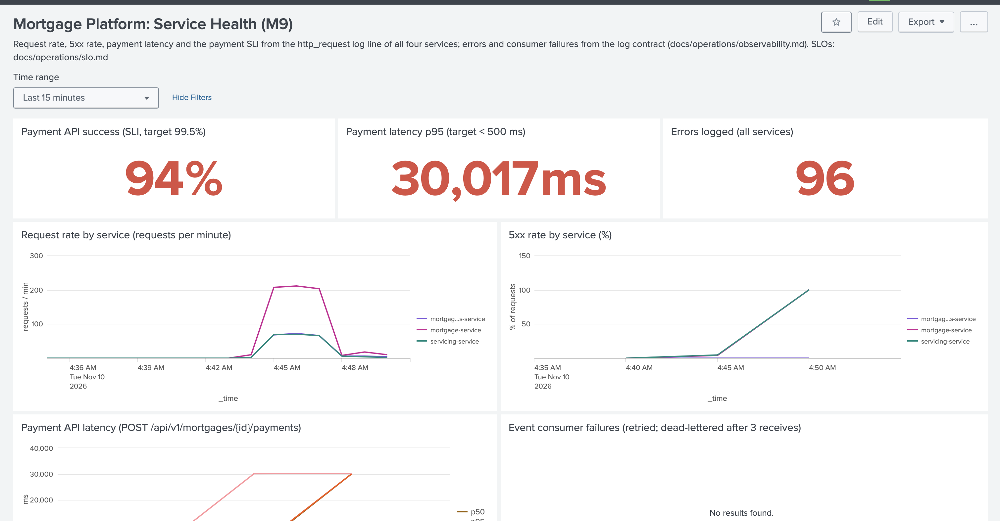
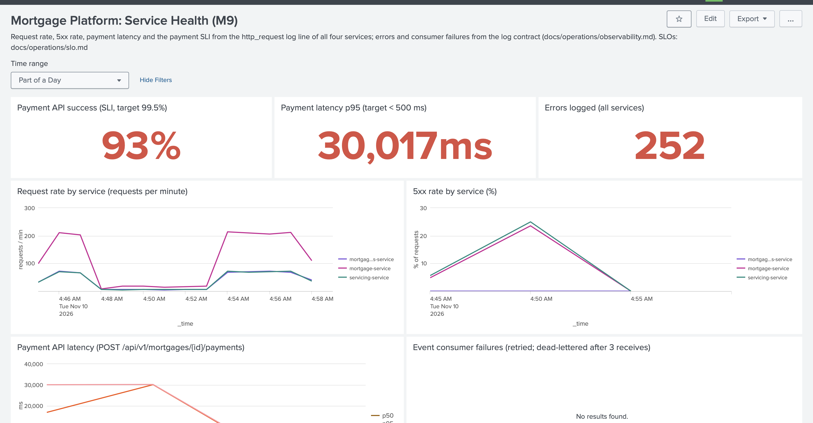

# RCA 2026-11-10: Payments failing during a PostgreSQL outage (incident simulation)

| | |
| --- | --- |
| **Type** | Planned incident simulation (M9 Task 9.4), local stack with local Splunk, index `mortgage_dev` |
| **Severity** | SEV-1 ([incident-response.md](incident-response.md#severity)): payments couldn't be posted |
| **Duration of impact** | 6 min 3 s (04:47:57Z – 04:54:00Z) |
| **Detected by** | Splunk alert *Error spike in a service*, 1 min 4 s after the failure |
| **IC / investigator** | akr12403 (single-person team) |
| **Evidence** | `scripts/incident/db_outage_drill.py` output, Splunk searches below, dashboard screenshots |
| **Status** | Resolved; actions tracked in [the backlog](../security/remediation-backlog.md) B-22…B-25 |

## 1. Summary

At 04:47:57 UTC the PostgreSQL container behind `mortgage-service` and `servicing-service` was stopped while the platform was serving about 60 payment requests a minute.

**What users saw.** Every request that needed the database **hung for 30 seconds** (the connection pool's timeout) and then failed with HTTP 500:
- 30 payment requests failed;
- the payment success rate for the incident window fell to 94.1% against the 99.5% SLO;
- p95 payment latency reached 30,014 ms against the 500 ms target.

Because each request hung for 30 seconds, throughput collapsed from about 60 payments a minute to about 6.

**Detection and recovery.**
- The *Error spike* alert fired after 1 min 4 s. Both payment SLO alerts fired at 3 min 3 s.
- Splunk triage identified the cause from the first failed request's log lines (`HikariPool-1 - Connection is not available … timed out after 30001ms`, `SQLState: 08001`).
- The database was restarted at 04:53:59, and payments succeeded again within 1 second, with no restart of the services.

**What we're changing.** No data was lost or posted twice. The main lessons are that the services should **fail fast** with a clear 503 instead of hanging for 30 s, and that the payment alerts were slowed down by their 5-minute window.

## 2. Impact

| Measure | Value | Source |
| --- | --- | --- |
| Customer-facing failure window | 04:47:57Z – 04:54:00Z (**6 min 3 s**) | injection → first successful payment |
| Failed payment requests (5xx, server side) | **30** of 510 in the drill window | `payment_totals` search |
| Payment requests the client gave up on (15 s client timeout) | 32. These are the same requests seen from the client side; the server failed them at 30 s. | traffic log |
| Payment success rate (SLI) in the drill window | **94.1%**: SLO 99.5% **breached** for the window | 480/510 |
| Payment p95 latency | **30,014 ms** (max 30,164 ms) during the outage; 57–185 ms before and after | `payments_per_minute` |
| Payment throughput | ~60/min before → **4–6/min** during → back to 54–72/min from 04:54 | `payments_per_minute` |
| Other services | `servicing-service`: 34 × 5xx (servicing history reads). `mortgage-analytics-service`: none, because event stats are served from memory. | `five_xx_by_service` |
| Errors logged | 184 (`mortgage-service`), 68 (`servicing-service`) | `errors_by_service` |
| Data integrity | No payment lost or duplicated. Failed requests weren't committed (one transaction per request), and retries with the same `Idempotency-Key` are replay-safe. | design (M5/M6) + smoke test |
| **Error budget** | 30 failures. At the drill's steady rate (~60 payments/min, ~2.6 M a month) the 30-day budget is ~12,960 failed payments, so this outage used **~0.2%** of it. At real, lower volumes the same 6-minute outage would use proportionally more. | [slo.md](slo.md) |

## 3. Timeline (UTC)

| Time | Event | Evidence |
| --- | --- | --- |
| 04:44:57 | Drill starts: 6 traffic workers, ~60 payments/min; all requests 2xx (payment p95 74–140 ms) | dashboard, `payments_per_minute` |
| **04:47:57** | **Failure injected:** `docker compose stop postgres` | drill log |
| 04:47:57–04:48:27 | Requests pile up waiting for a database connection; no error logged yet (Hikari waits 30 s) | throughput drop at 04:48 |
| **04:48:27** | First 5xx and first ERROR (`mortgage-service`), then `servicing-service` at 04:48:28 | `five_xx_by_service`, `errors_by_service` |
| **04:49:01** | **Alert fired: *Error spike in a service*** (≥ 10 ERROR lines in 5 min): **detection, 1 min 4 s after the failure** | Splunk triggered alerts |
| 04:49–04:51 | Triage: dashboard shows the payment SLI and p95 tiles red, and *Latest errors* names `mortgage-service` and `servicing-service`. Following one failed payment by `correlationId` shows the root cause directly (trace below). | dashboard screenshot, trace |
| **04:51:00** | **Alerts fired: *Payment API 5xx rate above 5%* and *Payment API p95 latency above 500 ms*** (3 min 3 s after the failure) | Splunk triggered alerts |
| 04:53:52 | Last 5xx (`mortgage-service`); `servicing-service` last at 04:53:53 | `five_xx_by_service` |
| **04:53:59** | **Mitigation:** `docker compose start postgres` | drill log |
| **04:54:00** | **Recovered:** first successful payment. The pool reconnected by itself; no service restart needed. | Splunk `http.status<500` after recovery |
| 04:54:06 | PostgreSQL container reports healthy | `docker inspect` |
| 04:54 | 72 payments in the first minute after recovery, all 2xx | `payments_per_minute` |
| 04:59:28 | Traffic ends; dashboard normal; incident closed | drill log, screenshot |

**Trace of one failed payment** (`correlationId=traffic-d2d1c30e-df88-4215-be10-517d58d7ebdb`). All four lines are in `mortgage-service` at 04:53:37:

```text
ERROR  The connection attempt failed.
WARN   SQL Error: 0, SQLState: 08001
ERROR  HikariPool-1 - Connection is not available, request timed out after 30001ms (total=0, active=0, idle=0, waiting=4)
INFO   http_request  POST /api/v1/mortgages/{id}/payments  status=500  durationMs=30013.4
```

`total=0` means the pool had no connections at all: the database was unreachable, not merely slow.

Dashboard during the outage (*Last 15 minutes* at about 04:50). The 5xx rate is climbing, and the SLI, p95 and error tiles are red:



The whole incident window (04:45:32–04:58:31Z): the request-rate collapse, the 5xx peak, and recovery at 04:54:



## 4. Root cause

**Technical cause.** PostgreSQL became unavailable, here by a deliberate container stop. `mortgage-service` and `servicing-service` keep no state outside the database, so every request needing a connection failed.

**Contributing factors.** These made the impact bigger, or the detection slower, than necessary:

1. **The services wait 30 s before failing.** HikariCP's `connection-timeout` is 30,000 ms (`application.yml`).
   - Each request held a server thread and a client connection for 30 s, so throughput fell to 4–6 payments a minute.
   - Callers saw timeouts instead of a fast, clear error; our own client gave up after 15 s.
   - The response was a generic `500 INTERNAL_ERROR`. A `503` with `Retry-After` would tell clients to retry instead of treating the payment as rejected.
2. **The payment alerts were diluted by their 5-minute window.** They evaluate the last 5 complete minutes:
   - At 04:50 that window (04:45–04:50) held 186 payments, of which 8 failed (4.3%, under the 5% threshold). The alerts only fired on the next run (04:46–04:51: 14 of 133, 10.5%).
   - The p95 alert is diluted the same way.
   - The generic error-spike alert detected the incident 2 minutes earlier.
3. **The drill's own traffic tripped the per-user write limit.** 78 payments were rejected with `429`, because all 6 drill workers used one user and the limit is 60 writes a minute.

   That's a tooling artifact, not user impact. But it revealed a **blind spot**: the rate limiter rejects requests in the security filter chain *before routing*, so those 429s are logged with `http.route=unmatched`. They don't appear in any payment-route search, the dashboard or the SLI.
4. **Nothing showed database health directly.** The cause was found from error messages. No panel or alert says "database unreachable" (for example, `HikariPool … request timed out`, or the actuator `db` health component going DOWN).

**What went well.**
- The structured logs with `correlationId` led straight from the alert to the cause in one search.
- Every service recovered by itself within 1 second of the database returning.
- No data was lost or duplicated.
- The event consumers didn't dead-letter anything, because the publisher failed before publishing.

## 5. Corrective actions (fix what broke)

| # | Action | Owner | Due |
| --- | --- | --- | --- |
| C-1 | **Fail fast on database unavailability (B-22).**<br>• Hikari `connection-timeout` 30 s → 3 s in both Java services.<br>• Map `CannotCreateTransactionException`/`DataAccessResourceFailureException` to **503 `SERVICE_UNAVAILABLE`** with `Retry-After: 5` in `GlobalExceptionHandler`, with tests.<br>• Expected result: failures in about 3 s instead of 30 s, and clients retry. | Backend lead | 2026-11-17 |
| C-2 | **Drill traffic uses several users** (one per worker, from the seeded roles), so the drill measures the incident and not the rate limiter. | Platform lead | 2026-11-12 |

## 6. Preventive actions (catch it sooner, keep it from recurring)

| # | Action | Owner | Due |
| --- | --- | --- | --- |
| P-1 | **Fast-burn payment alert (B-23):** 1-minute window, fires when ≥ 3 payment requests ran and ≥ 50% returned 5xx. It catches a full outage in about 1–2 minutes, while the 5-minute alerts keep catching partial degradation. Add it to `alerts.json` with a runbook link. | Platform lead | 2026-11-17 |
| P-2 | **Database-unreachable alert and dashboard tile (B-24):** `index=mortgage_dev "HikariPool" "Connection is not available"` (≥ 1 in 1 min). The runbook step now names this signature (done in this PR). | Platform lead | 2026-11-17 |
| P-3 | **Make rejected requests visible (B-25):** log the route template for requests rejected in the security chain (429/401/403), or add `http.rejected_by=rate_limit`. Add a *Throttled requests* panel. Throttled payments are still out of the SLI (they're client limits), but must be visible. | Backend lead | 2026-11-24 |
| P-4 | **Runbook:** the *payment API 5xx rate* section now lists this incident's log signature and the 30-second hang (done in this PR). | Platform lead | done |
| P-5 | **Repeat the drill after C-1 and P-1** and compare: expect detection under 2 min, failures in about 3 s, and throughput kept for the requests that don't need the database. | Platform lead | 2026-11-24 |
| P-6 | **For a shared environment:** a managed database (RDS Multi-AZ) and the ECS health check on `/actuator/health` (which includes the database), so a database failover is minutes, not manual. Recorded for the deployment design (no RDS in the sandbox, see [terraform.md](terraform.md#design-decisions)). | Platform lead | before go-live |

## Evidence searches (Splunk, index `mortgage_dev`)

Set the time range to 2026-11-10 04:44–05:00 UTC.

```text
index=mortgage_dev message=http_request service.name=mortgage-service http.method=POST http.route="/api/v1/mortgages/{id}/payments"
| bin _time span=1m | stats count as total, count(eval('http.status'>=500)) as failed, perc95(durationMs) as p95 by _time

index=mortgage_dev message=http_request http.status>=500 | stats count, min(_time) as first, max(_time) as last by service.name
index=mortgage_dev log.level=ERROR | stats count, values(error.type) by service.name
index=mortgage_dev correlationId="traffic-d2d1c30e-df88-4215-be10-517d58d7ebdb" | sort _time
index=_audit action=alert_fired ss_name="mortgage_dev - *" | table _time ss_name
```

Reproduce the drill with `python3 scripts/incident/db_outage_drill.py`, with the stack and local Splunk from `bash scripts/splunk/local-up.sh` running.
