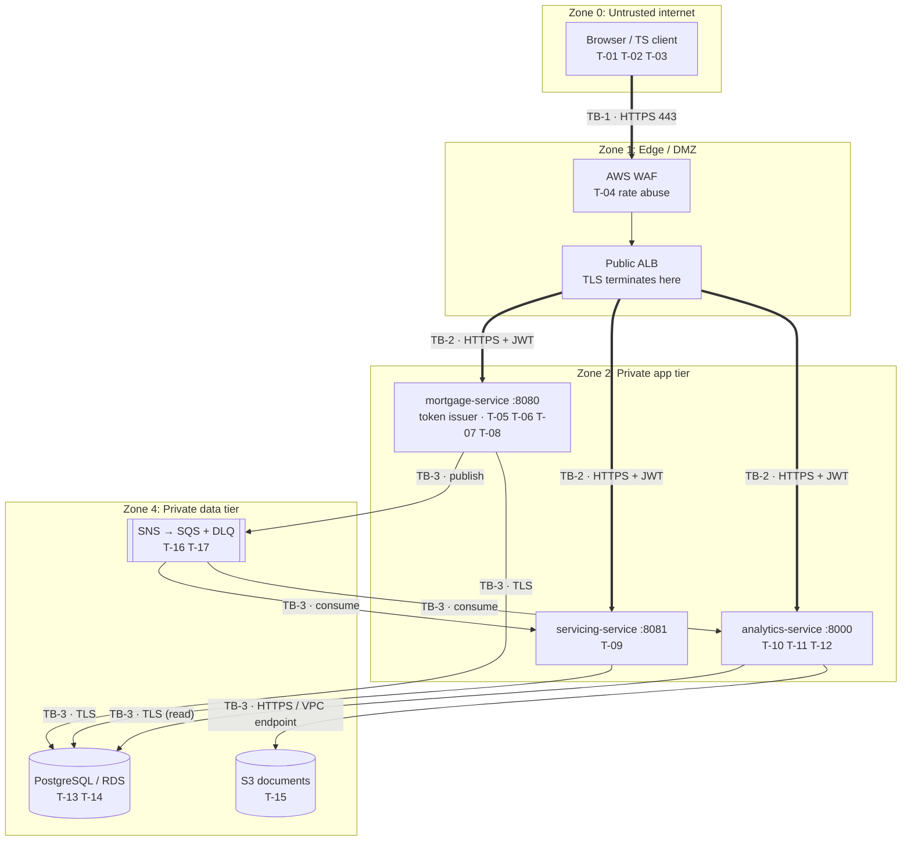
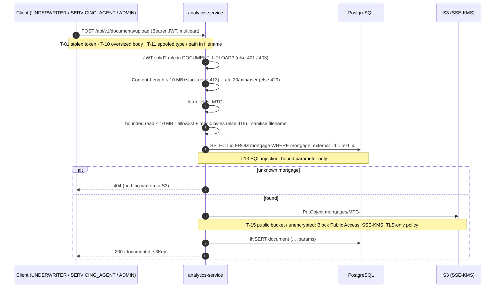
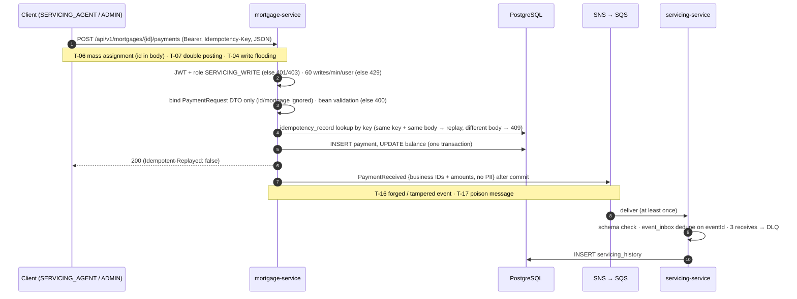

# Threat Model: STRIDE (M6 Task 6.6)

Built from the handbook outline (`reference/threat-model-outline.md`) and **our** M1 diagrams: [deployment-architecture.md](../architecture/deployment-architecture.md) and [trust-boundaries.md](../architecture/trust-boundaries.md). Each threat links to a [risk register](./risk-register.md) entry (`R-xx`) and, where it was found in testing, a [vulnerability report](./vulnerability-report.md) finding (`VULN-M6-xxx`).

## System overview

| | |
| --- | --- |
| Components | mortgage-service (origination, payments, auth issuer), servicing-service (history, delinquency), mortgage-analytics-service (analytics, document upload), PostgreSQL/RDS, S3 documents, SNS topic → SQS queues (+ DLQs), TypeScript client, CI pipeline (M2/M9). The knowledge assistant (M7) is out of scope until it exists. |
| Data assets | borrower PII (Confidential; DOB Restricted), loan and payment history (Confidential), underwriting documents (Restricted), JWTs and signing key (Restricted), DB credentials (Restricted). Classification: [security-controls.md](./security-controls.md#data-classification-task-65) |
| Actors | the five staff roles (ADMIN, UNDERWRITER, SERVICING_AGENT, RISK_ANALYST, SUPPORT), anonymous internet clients, a compromised insider or service, a CI contributor |
| Assumptions | AWS-managed infrastructure (ALB, RDS, S3, SNS/SQS, KMS) behaves as documented; the local stack holds only synthetic data |

## Diagram 1: deployment with numbered trust zones

An annotated copy of the M1 deployment diagram. `TB-n` are the M1 trust boundaries; `T-xx` are threats from the worksheet below.

Zone 3 (the AI assistant, TB-4) arrives in M7; its threat rows (prompt injection, PII in prompts) are added then.

## Diagram 2: document upload, with threats marked

## Diagram 3: payment post, with threats marked

## STRIDE worksheet

Status: **Mitigated** = control built and tested · **Partial** = the control exists but has a known limit · **Planned** = designed, in a later milestone · **Accepted** = see the risk register.

| ID | Component / boundary | Threat | STRIDE | Impact | Mitigation | Status | Risk / finding |
| --- | --- | --- | --- | --- | --- | --- | --- |
| T-01 | JWT (client ↔ any service) | Token theft and replay | Spoofing | API use as the victim for up to the TTL | 1 h TTL; HTTPS only (HSTS, TS client refuses HTTP off localhost); token in memory only; never logged | Partial (no revocation) | R-05, VULN-M6-011 |
| T-02 | `POST /auth/login` (TB-1) | Credential stuffing / brute force | Spoofing | Account takeover | 10/min per (IP, user) + 60/min per IP → 429; BCrypt(12); identical errors and timing for unknown users; MFA via the identity provider is on the roadmap | Mitigated (MFA planned) | R-01, VULN-M6-005 |
| T-03 | Client configuration | Base URL pointed at plain HTTP or a look-alike host | Spoofing / Info disclosure | Credentials or token sent in clear | TS client: env-only config, HTTPS required off localhost, no credentials in URLs | Mitigated | R-05 |
| T-04 | Edge and write APIs | Request flooding, expensive queries | Denial of service | Outage, cost | WAF (M9); per-user write limit; page size ≤ 100; date range ≤ 3660 days; upload ≤ 10 MB | Partial (in-memory limits) | R-09, VULN-M6-007, VULN-M6-017 |
| T-05 | mortgage-service token issuer | Forged token (`alg:none`, weak key, wrong issuer) | Spoofing / Elevation | Full access as any role | HS256 pinned; key ≥ 256 bit from env only, startup fails otherwise; issuer and expiry checked | Mitigated | R-03, VULN-M6-002 |
| T-06 | `POST /payments` | Mass assignment overwrites another payment | Tampering | Falsified financial records | Bind to `PaymentRequest` DTO; mortgage only from the URL | Mitigated | R-06, VULN-M6-001 |
| T-07 | `POST /payments` | Duplicate POST (retry, double click) | Tampering | Double posting | `Idempotency-Key` with request fingerprint; a mismatched body → 409 | Mitigated | R-06 |
| T-08 | `POST /underwriting-decision` | Caller claims a different approver role | Repudiation | Untrustworthy audit trail | Role taken from the verified JWT; subject and correlation ID in every log line | Mitigated | R-07, VULN-M6-004 |
| T-09 | Any endpoint | Role escalation or calling another role's function | Elevation | Separation of duties broken | URL-level RBAC for 5 roles, `denyAll()` by default, 403 before validation | Mitigated | R-02, VULN-M6-003 |
| T-10 | Upload | Oversized or repeated uploads | Denial of service | Storage and CPU exhaustion | 413 on declared and actual size; 20 uploads/min per user | Mitigated | R-09, VULN-M6-006 |
| T-11 | Upload | Executable or HTML disguised as a document; path in the filename | Tampering / Elevation | Malware stored and served to staff; key collisions | Type allowlist + magic bytes; filename sanitised; key built only from validated parts | Mitigated (malware scanning planned) | R-08, VULN-M6-006 |
| T-12 | Analytics risk summary | Borrower names returned to RISK_ANALYST | Info disclosure | PII beyond need-to-know | Names only for `BORROWER_PII_READ` roles | Mitigated (6.6) | R-10, VULN-M6-008 |
| T-13 | SQL layer (TB-3) | SQL injection | Tampering / Info disclosure | Data breach | Parameterised queries everywhere; static guard test; ID patterns at the edge | Mitigated | R-11 |
| T-14 | PostgreSQL / RDS | Stolen snapshot or disk; guessable DB password | Info disclosure | Full data breach | KMS-encrypted storage and snapshots; TLS `verify-full`; Secrets Manager with rotation; no default password | Planned (AWS) / Mitigated (no default, 6.6) | R-12, VULN-M6-009 |
| T-15 | S3 documents | Public bucket or unencrypted objects | Info disclosure | Restricted document leak | Block Public Access, SSE-KMS default, TLS-only bucket policy, least-privilege task role | Planned (M8/M9) | R-08 |
| T-16 | SNS/SQS | Forged or tampered event injected into a queue | Spoofing / Tampering | Wrong servicing history or delinquency | Only the mortgage-service role may publish (IAM and topic policy); JSON Schema validation; events carry business IDs, no PII | Partial (no message signing) | R-13 |
| T-17 | Consumers | Poison message loops; replays | Denial of service / Tampering | Stuck queue, duplicate history | 3 receives → DLQ; `event_inbox` dedupe on `eventId`; ack after commit | Mitigated | R-13 |
| T-18 | Logs (CloudWatch / Splunk) | PII or tokens in logs | Info disclosure | Compliance breach | Logs hold IDs, usernames and correlation IDs only; tokens and bodies never logged; KMS-encrypted log groups | Mitigated (review in M9) | R-14 |
| T-19 | All mutating routes | Action cannot be attributed | Repudiation | Audit gap | JWT required on every mutating route; `user=` and `correlationId=` on every log line, copied into events | Mitigated | R-07 |
| T-20 | Shared `JWT_SECRET` | A compromised validator mints tokens | Elevation | Platform-wide access | Same deployment controls for all services; RS256/JWKS planned | Accepted | R-04, VULN-M6-010 |
| T-21 | Secrets and config | Secrets committed or defaulted | Info disclosure | Credential exposure | `.env` git-ignored; secret scanning (M2, CI in Task 6.7); no default secrets (6.6); rotation runbook | Mitigated | R-12, VULN-M6-009 |
| T-22 | API inventory | Public `/docs`, internal UUIDs, server banner | Info disclosure | Easier reconnaissance | Disable docs outside local; remove UUIDs from responses; drop the server header | Planned | R-15, VULN-M6-015, VULN-M6-016 |
| T-23 | Cross-borrower access (outline's IDOR row) | User reads another borrower's mortgage by changing the ID | Elevation | Cross-borrower data leak | All five roles are staff with portfolio-wide duties, so ownership checks don't apply yet; RBAC limits PII to three roles; business IDs. **If a borrower-facing role is ever added, it needs per-borrower ownership checks.** | Accepted (no borrower role) | R-02 |
| T-24 | CI/CD pipeline | Malicious dependency or leaked pipeline secret | Tampering | Supply-chain compromise | SCA, SAST and secret scanning gates (Task 6.7, M9); protected branches with review (M2) | Planned (6.7) | R-16 |

## Walk-through for the demo: T-06 (mass assignment on payment post)

1. **Threat:** a servicing agent sends `POST /mortgages/MTG-1001/payments` with `"id"` set to an existing payment's UUID.
2. **Before:** the body was bound straight onto the JPA entity, and `save()` merged it, overwriting that payment's amount and status (Tampering of financial records).
3. **Mitigation:** the body binds to `PaymentRequest`, which has no `id` or `mortgage` field, so the server always creates a new row. The mortgage comes only from the URL.
4. **Evidence:** `MassAssignmentRegressionTest` and the live test `test_owasp_smoke.py::test_payment_body_cannot_choose_the_payment_id`, which shows the target payment unchanged.

## Sign-off

- [ ] Team peer review (date, reviewer)
- [ ] Instructor review (date)
- [x] Linked to risk register entries
